<h1 align="center">asa-slides</h1>

<p align="center">
An agent skill (<code>slide-interaktif-animatif</code>) that turns lecture, training, project or thesis material (PDF or Markdown) into an <b>interactive, animated HTML slide deck</b>, with motion-graphic explainers instead of bullet points.
</p>

<p align="center">
<a href="https://asashades.github.io/asa-slides/">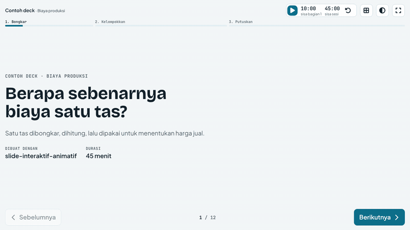</a>
</p>

<p align="center">
<a href="https://asashades.github.io/asa-slides/galeri-explainer.html"><b>Explainer gallery</b></a> ·
<a href="https://asashades.github.io/asa-slides/contoh-deck.html"><b>Example deck</b></a> ·
<a href="SKILL.md"><b>SKILL.md</b></a>
</p>

The animation above is a deck built on the skill's engine template. Decks run with the arrow keys only: right advances one animation step, then the next slide; left goes back; `G` opens a slide grid; typing a number and Enter jumps to a slide. Each deck has a section timer (optional), light and dark themes, quizzes (optional), and a print mode for PDF export.

> The demos use a small Indonesian bag-making business as the running case, so the on-screen text is Indonesian. A deck takes the language of its source material, and the skill's instructions are written in Indonesian.

## Why it exists

Most AI-generated slides are bullets with fade-in. This skill asks the agent to explain each key concept as a short animation that unfolds step by step, and to plan every deck with you before it writes any code.

- **Ask first.** The agent asks for the type of presentation (lecture, training, project, thesis defence), duration, audience, theme and palette, whether to include quizzes, 2D or 3D, and motion intensity.
- **Quizzes are optional.** Lectures and trainings can have quizzes, polls and timed exercises. Project presentations and thesis defences get a clean deck with no quiz slides, plus an optional backup section for Q&A.
- **Choose explainers.** It sends a gallery of explainer types and recommends two or three per concept.
- **Plan, then prototype, then build.** You approve a plan (run of show, slide list, storyboard per scene) and then a one-scene prototype before the full deck is made.
- **Meaningful 3D.** 3D scenes (three.js) must show a recognisable object, such as a product coming apart. Abstract boxes and spheres are not allowed.
- **Anti-slop checks.** An automated audit enforces no filler copy, Font Awesome icons instead of emoji, no coloured side or top stripes on cards, no purple gradients, no nested cards, and the rest of an anti-pattern list adapted from [impeccable.style](https://impeccable.style/anti-patterns).
- **Tested layouts.** Slides are checked for overflow at 1280×720, 1366×768, 1920×1080 and on a 390 px phone, in light and dark mode, with reduced motion respected.

## Explainer gallery

Thirteen of the thirty explainer types have a live demo (E1 also comes in 3D). Open the [interactive gallery](https://asashades.github.io/asa-slides/galeri-explainer.html) to step through them with the arrow keys.

<table>
<tr><td width="50%" align="center">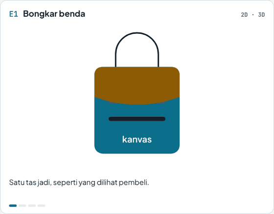<br><b>E1 · Take it apart</b><br><sub>Things made of components</sub></td><td width="50%" align="center">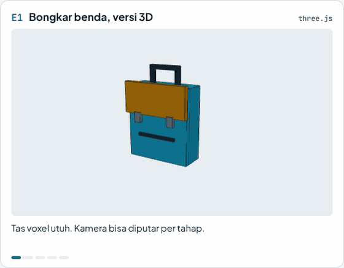<br><b>E1 · 3D · Take it apart, in 3D</b><br><sub>When depth helps: insides, layers, exploded views</sub></td></tr>
<tr><td width="50%" align="center">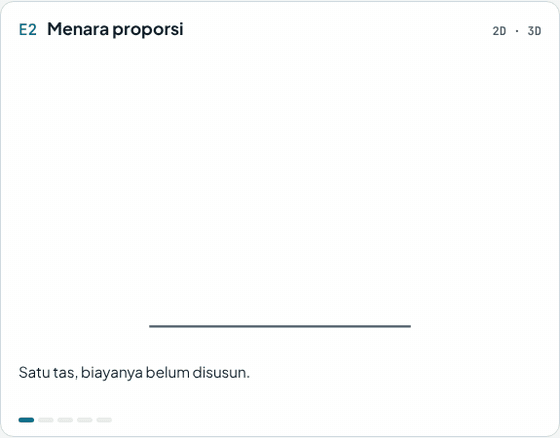<br><b>E2 · Proportion tower</b><br><sub>Composition of numbers and shares</sub></td><td width="50%" align="center">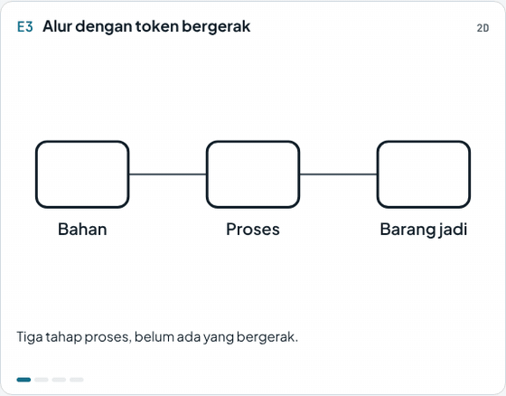<br><b>E3 · Flow with a moving token</b><br><sub>Sequential processes, cycles, material flow</sub></td></tr>
<tr><td width="50%" align="center">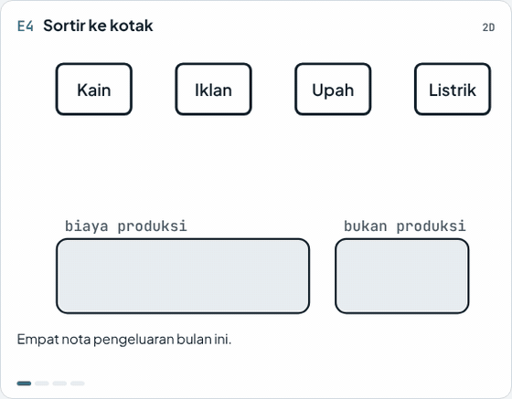<br><b>E4 · Sort into boxes</b><br><sub>Classification: what counts and what does not</sub></td><td width="50%" align="center">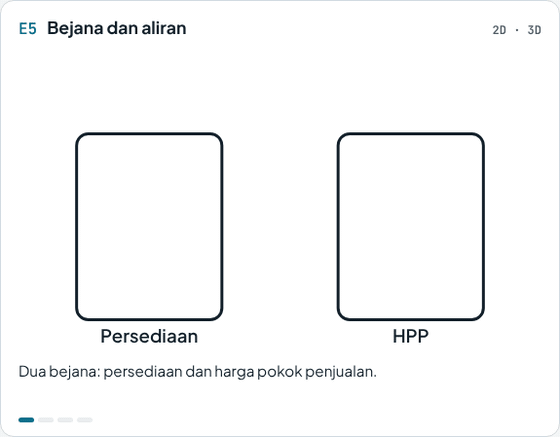<br><b>E5 · Vessels and flow</b><br><sub>Accumulation, inventory, leaks</sub></td></tr>
<tr><td width="50%" align="center">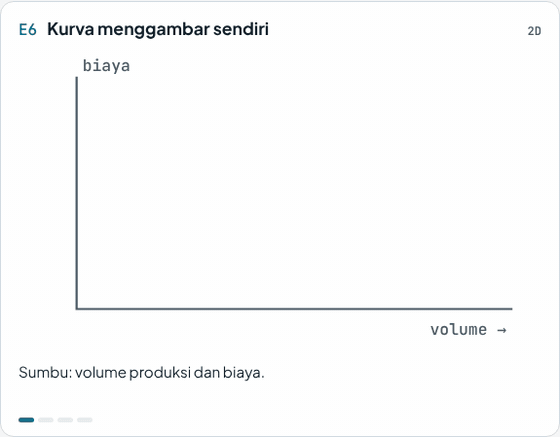<br><b>E6 · Self-drawing curve</b><br><sub>Behaviour against a variable, trends</sub></td><td width="50%" align="center">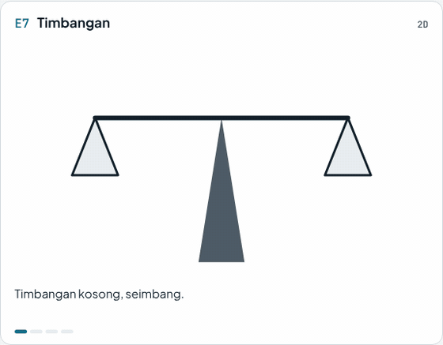<br><b>E7 · Balance scale</b><br><sub>Trade-offs, break-even</sub></td></tr>
<tr><td width="50%" align="center">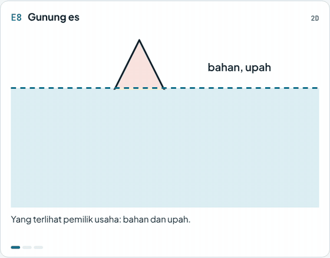<br><b>E8 · Iceberg</b><br><sub>Visible vs hidden, root causes</sub></td><td width="50%" align="center">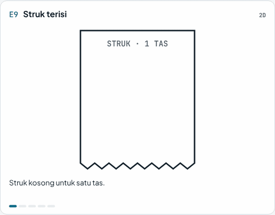<br><b>E9 · Receipt filling in</b><br><sub>Step-by-step calculation, building a total</sub></td></tr>
<tr><td width="50%" align="center">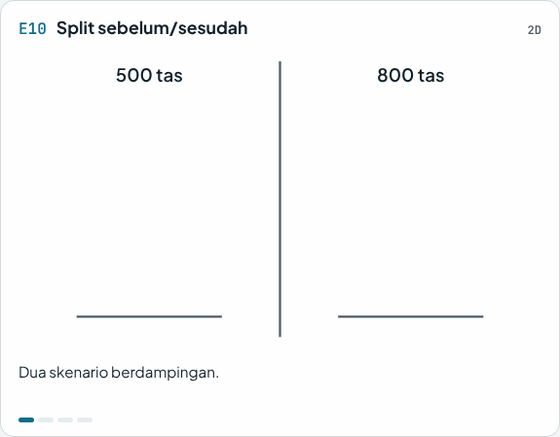<br><b>E10 · Before / after split</b><br><sub>Comparing scenarios, effect of a change</sub></td><td width="50%" align="center">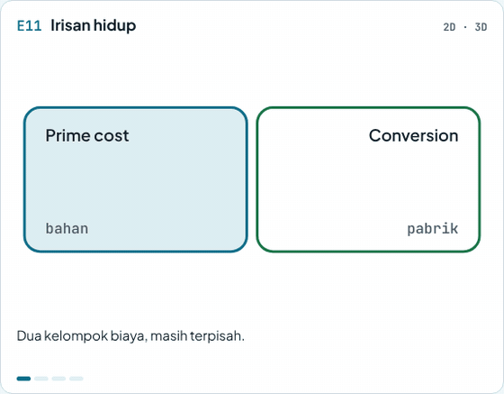<br><b>E11 · Living overlap</b><br><sub>Concepts that overlap</sub></td></tr>
<tr><td width="50%" align="center">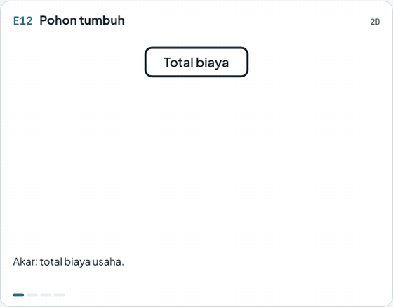<br><b>E12 · Growing tree</b><br><sub>Taxonomies, concept maps</sub></td><td width="50%" align="center">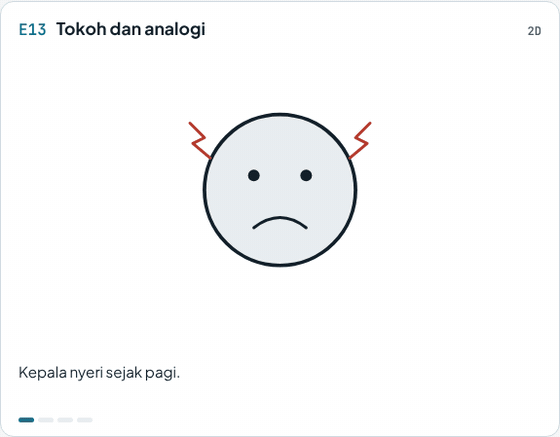<br><b>E13 · Character and analogy</b><br><sub>Everyday analogy, cause and effect</sub></td></tr>
</table>

### Also in the catalogue

E14 to E30 are written as recipes in [`references/katalog-explainer.md`](references/katalog-explainer.md): the SVG shape, the motion per step and the engine classes to use. The agent builds them on demand; they have no demo yet.

| Code | Explainer | Best for | Motion |
|---|---|---|---|
| E14 | Funnel | Shrinking stages (buyers, selection) | dots fall, some leave at each layer, layer counts tick up |
| E15 | Waterfall | Change from a start value to an end value | bars rise and fall in sequence with connector lines |
| E16 | Pareto | Few causes, large impact | sorted bars grow, cumulative line draws to 80% |
| E17 | Pictogram (unit chart) | Proportions that need to feel real | 100 icons, some change colour or leave |
| E18 | Filling donut | Percentage composition | slices grow one by one, percentages count up |
| E19 | Bar chart race | Rank or value changes over time | bars lengthen, shorten and swap order |
| E20 | Sankey | Branching flow of value | ribbons draw with width proportional to value |
| E21 | Gauge | One indicator against a safe limit | needle swings into the red, yellow or green zone |
| E22 | Cycle | Repeating processes (PDCA, accounting cycle) | stages light up in turn, circular arrows |
| E23 | Fishbone | Root causes by category | spine draws, 6M branches appear |
| E24 | Queue | Arrivals, service, bottlenecks | customers arrive, wait and get served, queue length changes |
| E25 | Material flow map | Layout and travel distance | flow lines draw over a floor plan, distances add up (2D or 3D) |
| E26 | Moving Gantt | Scheduling, critical path | task bars appear, a today line moves |
| E27 | Gears | Dependencies between parts | one gear turns the others (2D or 3D) |
| E28 | 2×2 matrix | Two-criteria classification | dots move into quadrants |
| E29 | Cause-effect dominoes | Chains of impact | tiles fall in sequence (2D or 3D) |
| E30 | Stepped zoom | Macro to micro | camera zooms in stage by stage (2D or 3D) |

## How a session goes

1. **Read the material.** Main message, five to eight concepts worth animating, numbers that can be computed, a case to follow.
2. **Basic questions.** Presentation type, duration, audience, theme, palette, quiz or no quiz.
3. **Pick explainers** per concept, from the gallery and the agent's recommendations.
4. **Choose a through-line.** One running story, or separate examples.
5. **Plan** the run of show, numbered slide list and storyboard. Wait for approval.
6. **Prototype** the cover and one key scene. Wait for approval.
7. **Build the full deck** from `assets/engine-template.html`.
8. **Test and deliver.** Layout test, anti-slop audit, contact sheets, optional PDF.

## Install

- **Claude (claude.ai or Claude Code):** upload this folder as a skill, or copy the contents of this repository to `~/.claude/skills/slide-interaktif-animatif/` (the skill name is set in `SKILL.md`; the repository name is only a label).
- **Hermes or another agent:** copy the folder into the agent's skills directory and make sure it reads `SKILL.md`.

Then send the agent a PDF or Markdown file and ask for an interactive slide deck. Say what it is for (a lecture, a project demo, a thesis defence) and the agent will adapt the structure and ask whether you want quizzes.

The scripts need Node.js 18 or newer:

```bash
npm install
npx playwright install chromium

npm run cek-template                     # test the bundled template
npm run uji -- deck.html                 # overflow, phone, arrows, quiz, grid, JS errors
npm run audit -- deck.html               # anti-slop audit, light and dark
npm run pdf -- deck.html deck.pdf        # PDF with every slide at its final step
npm run ikon -- --inject deck.html chevron-left chevron-right
```

To re-record the GIFs in this README (needs `ffmpeg`):

```bash
npm run gif -- docs/galeri-explainer.html docs/media/explainers
npm run hero -- docs/contoh-deck.html docs/media/hero.gif --slides=0,1,3,5,9
```

## Repository layout

```
SKILL.md                      8-phase workflow, read by the agent
references/
  katalog-explainer.md        E1-E30 explainer types, recipes, storyboard template
  jenis-presentasi.md         presentation types (lecture, training, project, thesis) and their defaults
  tema.md                     themes (clean, minimalist, editorial, neobrutalism, pixel art) and palettes
  anti-slop.md                anti-slop rules and the codes the audit reports
  mesin-slide.md              how to write slides in the engine template
  3d-threejs.md               rules for 3D scenes
assets/
  engine-template.html        single-file slide engine, the starting point of every deck
  galeri-explainer.html       live gallery sent to the user when choosing explainers
scripts/
  uji-deck.js                 layout and interaction tests
  audit-slop.js               automated anti-slop audit
  kontak-sheet.js             contact sheet of all slides
  render-pdf.js               PDF export
  fa-sprite.js                inline Font Awesome icon sprite
  rekam-gif.js                record each gallery card as a GIF
  rekam-deck-gif.js           record slides of a deck as one GIF
docs/                         GitHub Pages site: gallery, example deck, README media
```

## GitHub Pages

The `docs/` folder is the site. In the repository, open Settings, then Pages, choose the `main` branch and the `/docs` folder. The live gallery and example deck load fonts from Google Fonts and three.js from cdnjs, so they need an internet connection.

## Licence

[MIT](LICENSE), copyright 2026 Arga Seta Asmara Sakti.

Third-party material keeps its own licence:

- Icons: [Font Awesome Free](https://fontawesome.com/license/free), CC BY 4.0, embedded as inline SVG.
- 3D scenes load [three.js](https://threejs.org) r128 (MIT) from cdnjs.
- The anti-pattern list is adapted from [impeccable.style](https://impeccable.style/anti-patterns).
